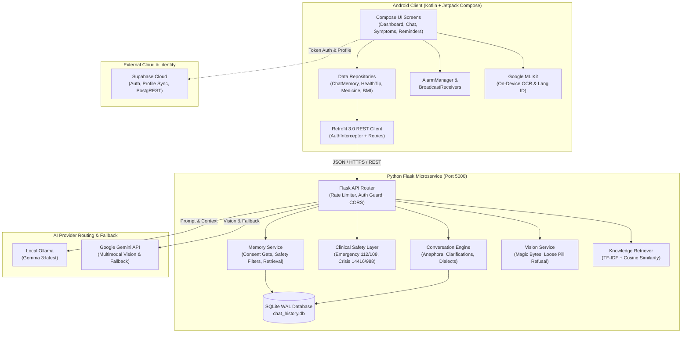
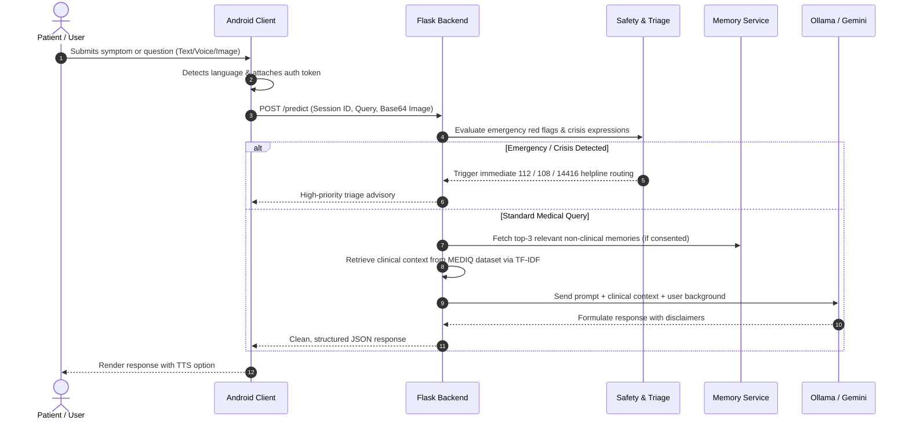
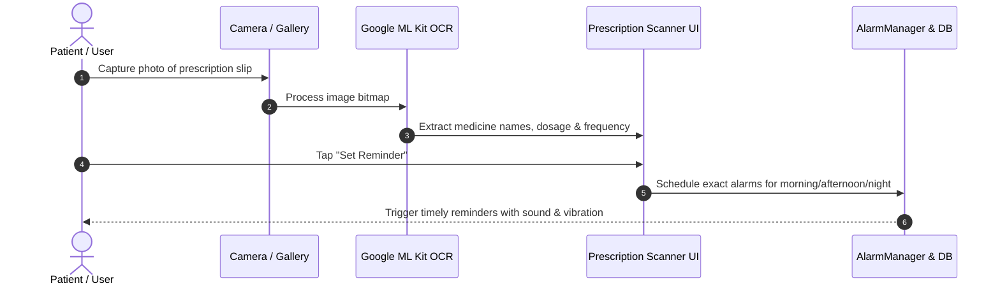
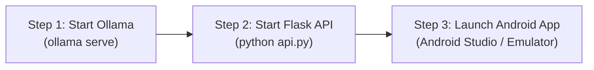

# MedAssist AI — Intelligent Multilingual Medical Assistant

<div align="center">


**A secure, clinically safe, cross-platform medical communication and patient assistance ecosystem.**
Engineered with a native Android client (Jetpack Compose, Clean Architecture) and an intelligent hybrid Python Flask backend powered by local Ollama (Gemma 3), Google Gemini Multimodal Vision, Scikit-Learn intent classification, and SQLite Write-Ahead Logging.

</div>

---

## 📋 Table of Contents

- [1. Project Overview](#1-project-overview)
- [2. Abstract](#2-abstract)
- [3. Problem Statement](#3-problem-statement)
- [4. Project Objectives](#4-project-objectives)
- [5. Key Features](#5-key-features)
- [6. Technology Stack](#6-technology-stack)
- [7. System Architecture](#7-system-architecture)
- [8. Application Workflow](#8-application-workflow)
- [9. Project Folder Structure](#9-project-folder-structure)
- [10. Android Application Setup](#10-android-application-setup)
- [11. Python Flask Backend Setup](#11-python-flask-backend-setup)
- [12. Ollama & Gemma 3 Setup](#12-ollama--gemma-3-setup)
- [13. Database Architecture & Storage](#13-database-architecture--storage)
- [14. API Endpoints Reference](#14-api-endpoints-reference)
- [15. User Interface & Screen Overview](#15-user-interface--screen-overview)
- [16. How to Build the APK](#16-how-to-build-the-apk)
- [17. How to Run the Complete Project](#17-how-to-run-the-complete-project)
- [18. Testing & Quality Assurance](#18-testing--quality-assurance)
- [19. Limitations](#19-limitations)
- [20. Future Scope](#20-future-scope)
- [21. Privacy & Security Considerations](#21-privacy--security-considerations)
- [22. Clinical & Medical Disclaimer](#22-clinical--medical-disclaimer)
- [23. Contributors & Acknowledgments](#23-contributors--acknowledgments)
- [24. License](#24-license)

---

## 1. Project Overview

**MedAssist AI** is an end-to-end medical assistant designed to bridge the gap between primary healthcare awareness, symptom triage, medication adherence, and daily preventative health routines. The system combines:
1. **A Native Android Mobile Application:** Developed with 100% Kotlin and modern declarative Jetpack Compose, offering biometric authentication, offline-resilient caching, Google ML Kit OCR, and high-precision medication scheduling.
2. **A Clinically Guarded Flask Microservice Backend:** Hosting an offline-capable conversational engine powered by local **Ollama with Google Gemma 3**, supplemented with **Google Gemini Multimodal Vision** for pharmaceutical label analysis, Scikit-Learn TF-IDF clinical knowledge retrieval, and SQLite Write-Ahead Logging.

The system is built specifically with multi-tier guardrails to uphold strict clinical safety: it detects acute emergencies (routing to **112 / 108**), identifies mental health crises (routing to **Tele-MANAS 14416 / 988**), strictly refuses to identify unpackaged loose pills by sight, and neutralizes adversarial prompt injection.

---

## 2. Abstract

Access to timely, accurate, and culturally contextualized medical information is a widespread challenge in multilingual societies. Patients frequently encounter difficulties interpreting complex pharmaceutical packaging, recalling daily medication schedules, tracking chronic lifestyle metrics, and navigating early symptoms without succumbing to health misinformation.

**MedAssist AI** addresses these challenges by delivering an accessible, AI-powered healthcare companion. Utilizing an on-device/edge-first paradigm, the Android application provides native multilingual support across **English, Marathi (मराठी), and Hindi (हिन्दी)**. The backend pairs a local Large Language Model (**Ollama Gemma 3**) with a clinical knowledge retrieval pipeline indexing over **17,500+ MEDIQ medical query pairs**. Optical Character Recognition (OCR) powered by Google ML Kit enables digital prescription ingestion, directly bridging diagnostic documentation to an on-device `AlarmManager` routine reminder system. All conversational memory is user-consented, client-isolated, and strictly filtered to ensure zero retention of sensitive clinical diagnoses or prescription records in long-term memory.

---

## 3. Problem Statement

1. **Healthcare Literacy & Accessibility Barriers:** Clinical consultations and prescription instructions are frequently delivered in language or formats that laypersons—especially non-English speakers—find challenging to comprehend.
2. **Medication Non-Adherence:** Forgetting dosages or misinterpreting administration schedules (e.g., before vs. after meals) leads to adverse drug events and suboptimal therapeutic outcomes.
3. **Misinformation & Unsafe Self-Medication:** Public LLMs often hallucinate unauthorized dosages, misidentify loose pills based purely on visual appearance, or fail to prioritize immediate emergency escalation during life-threatening events.
4. **Data Privacy in Healthcare AI:** Commercial medical conversational agents frequently store sensitive medical histories, diagnoses, and lab vitals without explicit user control or granular memory revocation.

---

## 4. Project Objectives

- **Develop a Responsive, Native Mobile Client:** Build a clean, responsive Jetpack Compose application supporting dual Light/Dark healthcare themes and seamless multilingual localization (English, Marathi, Hindi).
- **Implement Multimodal Clinical Vision:** Extract textual metadata from prescription slips and pharmaceutical blister packaging via Google ML Kit OCR and Gemini Vision while refusing unsafe loose pill identification.
- **Architect Safe, Multi-Turn Medical Conversations:** Leverage local Ollama (Gemma 3) and TF-IDF retrieval over curated clinical corpora with explicit pronoun resolution and follow-up ambiguity clarification.
- **Establish Automated Routine & Medicine Scheduling:** Utilize Android's low-level `AlarmManager` and broadcast receivers for deterministic, battery-optimized medication and wellness habit alerts that survive device reboots.
- **Enforce Stringent Medical Guardrails:** Intercept red-flag emergency symptoms and mental health crises with immediate statutory helpline routing, prompt injection neutralization, and zero-trust long-term memory isolation.

---

## 5. Key Features

### 👤 1. User Registration, Authentication & Biometrics
- **Supabase Cloud Authentication:** Email and password sign-in, account creation, and secure token lifecycle management.
- **Biometric Authentication:** One-touch fingerprint and facial authentication via `androidx.biometric:biometric` for rapid, secure app access.
- **Guest Access Mode:** Allows users to access essential informational modules (Symptom Checker, BMI Calculator, Health Tips) without requiring account creation.

### 🤖 2. Context-Aware AI Medical Chatbot
- **Multi-Turn Symptom Tracking:** Tracks symptom progression, duration, and severity across conversational turns.
- **Anaphora & Reference Resolution:** Understands contextual pronouns (*"Can I take it with food?"*, *"What are its side effects?"*).
- **Ambiguity Clarification:** Detects vague complaints (e.g., *"stomach pain"*, *"headache"*) and asks focused clinical clarifying questions before generating guidance.
- **Voice Input & TTS Output:** Integrated speech-to-text input and spoken audio responses via Android Text-To-Speech.
- **Image Attachment:** Direct camera capture or gallery selection for pharmaceutical label verification.

### 🌐 3. Multilingual Support (English, Marathi, Hindi)
- Native Devanagari script support for **Marathi (`mr`)** and **Hindi (`hi`)**, alongside standard English.
- Script and dialect classification handles pure Devanagari, Hinglish, and Romanized Marathi (*"Majhe doke dukhat ahe"*).
- In-screen language selector within Health Tips and Medicine Info allows on-the-fly toggling without altering system language.

### 🩺 4. Interactive Symptom Checker
- Categorized symptom exploration across anatomical regions (Respiratory, Digestive, Neurological, Skin, Musculoskeletal).
- Multi-symptom aggregation calculates clinical risk tiering, recommended care levels, and red-flag escalation alerts.

### 📷 5. Prescription Scanner via Google ML Kit OCR
- Camera and gallery document scanning using on-device `com.google.mlkit:text-recognition`.
- Parses medicine names, dosage strengths, administration frequencies, and timing instructions from complex prescription labels.
- One-click **"Set Reminder"** shortcut transfers scanned dosage instructions directly into the reminder creation flow.

### 💊 6. Comprehensive Medicine Information Library
- Searchable reference repository covering common generic and branded pharmaceuticals.
- Details therapeutic uses, adult and pediatric dosages, precautions, contraindications, and potential adverse effects.
- Complete multilingual translation in English, Marathi, and Hindi.

### ⚖️ 7. Precision BMI Calculator & Speedometer Gauge
- Interactive height (cm / ft-in) and weight (kg / lbs) pickers with instantaneous metric conversion.
- Custom Canvas-rendered **Speedometer Gauge** dynamically positions an animated indicator across WHO weight classifications (Underweight, Normal, Overweight, Obese Class I–III).
- Generates tailored daily caloric targets, lifestyle advice, and target healthy weight ranges.

### ⏰ 8. Medicine Reminders & Alarms
- Schedule custom daily medication reminders categorized by morning, afternoon, evening, and night slots.
- Configure meal-timing tags (Before Food / After Food) and treatment duration days.
- Uses Android `AlarmManager` exact alarms with automatic re-scheduling upon device reboot (`RECEIVE_BOOT_COMPLETED`).

### 🌿 9. Health Tips & Wellness Recommendations
- 22 curated evidence-based health and lifestyle tips organized into 6 core categories:
  - *Nutrition & Hydration*, *Physical Activity*, *Mental Wellness*, *Sleep & Recovery*, *Preventive Care*, *Immunity Boosters*.
- Dedicated **Health Tip Details** view presenting target demographics, related symptoms, personalized suggestions, benefits, and precautions.

### 🔔 10. Smart Health Tip Routine Reminder System
- Add recurring routine reminders directly from any Health Tip (e.g., *"Morning Amla Habit"*, *"30-Minute Brisk Walk"*).
- Flexible recurrence frequencies: **Once**, **Daily**, or **Weekly** (with custom day-of-week chip selection).
- Features a **Next Scheduled Routine** hero card, active/inactive switches, and full reboot resilience via `HealthTipReminderBootReceiver`.

### 🛡️ 11. User-Scoped Long-Term Memory & Consent
- **Opt-In Privacy Architecture:** Long-term memory is **OFF by default** and strictly requires authenticated user consent.
- **Clinical Safety Filter:** Rejects sensitive clinical items (diagnoses, prescription dosages, allergies, lab metrics) from persistent storage; only captures lifestyle and communication preferences.
- **Granular User Controls:** View, edit, delete individual memories, or execute a complete memory wipe via User Profile settings.

### 🕵️ 12. Temporary Chat Mode (Incognito)
- One-tap toggle disables all conversation persistence and bypasses long-term memory reading/writing for sensitive queries.

### 🎨 13. Dynamic Light & Dark Theme System
- Application-wide cohesive theme built upon a medical teal aesthetic (`DarkTeal #0D9488`, `DeepTeal #0F766E`, `SoftMint #F0FDFA`).
- Manual toggle between Light Mode, Dark Mode, or System Default with real-time UI re-composition.

---

## 6. Technology Stack

### Mobile Client (Android)
| Layer / Component | Technology | Version / Specification |
| :--- | :--- | :--- |
| **Language** | Kotlin | `2.0+` |
| **Min / Target SDK** | Android SDK | Min: `24` (Nougat 7.0) \| Target: `36` (Android 16) |
| **UI Framework** | Jetpack Compose (Material 3) | Compose BOM `2024.09.00` |
| **Architecture** | Clean Architecture / MVI-StateFlow | Unidirectional Data Flow (UDF) |
| **Networking** | Retrofit & OkHttp | Retrofit `3.0.0` \| OkHttp `4.12.0` |
| **Cloud & Auth** | Supabase Android SDK | BOM `3.2.0` (`auth-kt`, `postgrest-kt`, `storage-kt`) |
| **On-Device OCR** | Google ML Kit | Text Recognition `16.0.1` \| Language ID `17.0.6` |
| **Biometrics** | AndroidX Biometric | `1.1.0` |
| **Serialization** | Google Gson | `2.10.1` |
| **Unit Testing** | JUnit 4 & AndroidX Test | 154 JVM Unit Tests Passed (100% Success) |

### Backend Microservice (Python Flask)
| Component | Technology | Version / Specification |
| :--- | :--- | :--- |
| **Framework** | Flask | `3.1.3` (Werkzeug `3.1.8`) |
| **Runtime** | Python | `3.10+` |
| **Primary Local LLM** | Ollama (Local Inference) | Google Gemma 3 (`gemma3:latest` / `medassist`) |
| **Vision / Fallback AI** | Google GenAI SDK | Google Gemini Multimodal Vision (`google-genai`) |
| **Machine Learning** | Scikit-Learn, NumPy, Pandas | `scikit-learn 1.5.2`, `numpy 1.26.4`, `pandas 2.2.3` |
| **Intent Classification** | Joblib Serialized Pipeline | `medical_intent_model.joblib` |
| **Database** | SQLite 3 | WAL Mode Enabled (`chat_history.db`) |
| **Production Server** | Gunicorn (Linux/WSL) / Flask WSGI | Multithreaded Worker Model |

---

## 7. System Architecture



---

## 8. Application Workflow

### 1. Clinical Chat & Inference Workflow


### 2. Prescription Scanning & Reminder Pipeline


---

## 9. Project Folder Structure

```
AI-Based-Medical-Chatbot/
├── app/                                    # Android Native Application
│   ├── build.gradle.kts                    # App-level build config, SDKs, dependencies
│   ├── proguard-rules.pro                  # R8 / ProGuard optimization rules
│   └── src/
│       ├── main/
│       │   ├── AndroidManifest.xml         # Permissions, receivers, activities
│       │   ├── java/
│       │   │   ├── SplashScreen.kt         # Startup brand screen
│       │   │   ├── com/example/ai_based_medical_chatbot/
│       │   │   │   ├── AppLanguage.kt      # Multilingual enums (EN, MR, HI)
│       │   │   │   ├── AppStrings.kt       # Localized string resource maps
│       │   │   │   ├── AppTheme.kt         # Theme state and composition locals
│       │   │   │   ├── ChatMemoryRepository.kt   # Memory sync and local cache
│       │   │   │   ├── HealthTipReminder.kt      # Habit reminder data model
│       │   │   │   ├── HealthTipReminderRepository.kt # Habit reminder persistence
│       │   │   │   ├── HealthTipReminderScheduler.kt  # AlarmManager habit scheduler
│       │   │   │   ├── MainActivity.kt     # Single-activity navigation host
│       │   │   │   ├── MedicineReminderRepository.kt  # Pill reminder persistence
│       │   │   │   ├── MedicineReminderScheduler.kt   # Pill alarm scheduler
│       │   │   │   ├── data/
│       │   │   │   │   ├── SupabaseClient.kt    # Auth and profile REST integration
│       │   │   │   │   └── api/
│       │   │   │   │       ├── ApiModels.kt     # Retrofit DTO request/response schemas
│       │   │   │   │       ├── MedicalApiService.kt # Retrofit interface declarations
│       │   │   │   │       └── RetrofitClient.kt# OkHttp client, baseUrl, retries
│       │   │   │   └── ui/theme/           # Design system (Color, Shape, Theme, Type)
│       │   │   └── ui/                     # Jetpack Compose UI Screens
│       │   │       ├── AddHealthTipReminderDialog.kt # Habit reminder dialog
│       │   │       ├── BMICheckerScreen.kt # BMI input, calculations, results
│       │   │       ├── BmiSpeedometerGauge.kt # Custom Canvas speedometer gauge
│       │   │       ├── ChatbotScreen.kt    # Main conversational interface
│       │   │       ├── ChatHistoryScreen.kt# Archived conversation list
│       │   │       ├── DashboardScreen.kt  # Primary hub & feature grid
│       │   │       ├── HealthProfileScreen.kt # User medical metrics & sync
│       │   │       ├── HealthTipDetailScreen.kt # Expanded tip info & habit setup
│       │   │       ├── HealthTipReminderScreen.kt # Habit reminder management
│       │   │       ├── HealthTipsScreen.kt # Categorized health tip list
│       │   │       ├── LoginScreen.kt / RegisterScreen.kt # Authentication UI
│       │   │       ├── MedicineDetailScreen.kt / MedicineInfoScreen.kt # Medicine library
│       │   │       ├── MedicineReminderScreen.kt # Pill alarm configuration
│       │   │       ├── PrescriptionScannerScreen.kt # ML Kit OCR document scanner
│       │   │       ├── ProfileScreen.kt    # Settings, memory controls, theme toggle
│       │   │       ├── SymptomsCheckerScreen.kt # Multi-symptom triage analyzer
│       │   │       └── VoiceAssistant.kt   # Speech recognition & TTS bridge
│       │   └── res/                        # Drawables, mipmaps, XML configurations
│       └── test/                           # 154 JVM Unit Test Suites
├── ml/                                     # Python Flask Backend Microservice
│   ├── api.py                              # Core Flask API, rate limits, routes
│   ├── conversation_engine.py              # Follow-up resolution, dialect classification
│   ├── memory_service.py                   # User-scoped long-term memory & consent
│   ├── vision_service.py                   # Magic byte validation, loose pill refusal
│   ├── requirements.txt                    # Python dependencies
│   ├── data/                               # Datasets and SQLite database
│   │   ├── chat_history.db                 # SQLite WAL conversation & memory store
│   │   ├── raw/
│   │   │   ├── medical_intents.csv         # Intent classification dataset
│   │   │   ├── medical_knowledge.csv       # Clinical conditions & guidelines
│   │   │   └── mediq/                      # 17,500+ MEDIQ query-answer pairs
│   └── models/
│       └── medical_intent_model.joblib     # Pre-trained Scikit-Learn intent model
├── .env.example                            # Template for environment configuration
├── .gitignore                              # Git exclusion patterns
├── build.gradle.kts                        # Top-level project build configuration
├── gradle.properties                       # JVM memory allocations and AndroidX flags
├── gradlew / gradlew.bat                   # Gradle wrapper scripts for Linux / Windows
└── README.md                               # Project documentation
```

---

## 10. Android Application Setup

### Prerequisites
- **Android Studio:** Ladybug (2024.2.1) or newer recommended.
- **Java Development Kit (JDK):** JDK 17 or JDK 21 configured as the Gradle JDK.
- **Android SDK:** Platforms `24` through `36` installed via Android SDK Manager.
- **Hardware / Emulator:** An Android Virtual Device (AVD) running API 26+ or a physical Android phone with USB Debugging enabled.

### Configuration Steps
1. **Clone the Repository:**
   ```bash
   git clone https://github.com/Prajwal-Bansode17/AI-Based-Medical-Chatbot.git
   cd AI-Based-Medical-Chatbot
   ```
2. **Configure API URL in `local.properties`:**
   Open or create `local.properties` in the project root and specify the backend address:
   ```properties
   sdk.dir=C\:\\Users\\<YOUR_USERNAME>\\AppData\\Local\\Android\\Sdk
   # Use 10.0.2.2:5000 for standard Android Studio Emulator:
   MEDASSIST_API_URL=http://10.0.2.2:5000/
   # OR use your computer's local Wi-Fi IP for a physical device:
   # MEDASSIST_API_URL=http://192.168.1.50:5000/
   ```
3. **Sync Project with Gradle Files:**
   Open the root directory in Android Studio and select **File > Sync Project with Gradle Files**.

---

## 11. Python Flask Backend Setup

### Prerequisites
- **Python:** Version `3.10` or `3.11` (64-bit).
- **Git** and standard terminal utilities.

### Setup Instructions (Windows)
1. **Open PowerShell in the Project Root:**
   ```powershell
   cd D:\AI-Based-Medical-Chatbot\ml
   ```
2. **Create and Activate a Virtual Environment:**
   ```powershell
   python -m venv venv
   .\venv\Scripts\Activate.ps1
   ```
3. **Install Dependencies:**
   ```powershell
   pip install --upgrade pip
   pip install -r requirements.txt
   ```
4. **Configure Environment Variables (`.env`):**
   Copy `.env.example` in the project root to `.env`:
   ```powershell
   copy ..\.env.example ..\.env
   ```
   Edit `.env` and configure your keys:
   ```ini
   # Google Gemini API Key (Required for Multimodal Vision & Fallback)
   GEMINI_API_KEY=your_gemini_api_key_here

   # Ollama Configuration (Local Offline LLM)
   OLLAMA_ENABLED=1
   OLLAMA_BASE_URL=http://localhost:11434
   OLLAMA_MODEL=gemma3:latest

   # Server Settings
   PORT=5000
   RATE_LIMIT_PER_MINUTE=120
   CHAT_DB_FILE=ml/data/chat_history.db

   # Supabase Configuration
   SUPABASE_URL=https://your-project.supabase.co
   SUPABASE_ANON_KEY=your_supabase_anon_key_here
   ```
5. **Start the Flask Microservice:**
   ```powershell
   python api.py
   ```
   *The server initializes on `http://0.0.0.0:5000` with SQLite WAL mode enabled.*

---

## 12. Ollama & Gemma 3 Setup

MedAssist AI uses **Ollama** running Google's **Gemma 3** as its primary on-premise, zero-cost conversational LLM for medical queries.

1. **Install Ollama:**
   Download and install Ollama from [ollama.com](https://ollama.com/download) for Windows / Linux / macOS.
2. **Verify Ollama Service:**
   Confirm Ollama is active by opening a terminal:
   ```powershell
   ollama --version
   ```
3. **Pull the Gemma 3 Model:**
   ```powershell
   ollama pull gemma3:latest
   ```
   *(Alternatively, lightweight variants such as `gemma:2b` or fine-tuned custom models can be set via `OLLAMA_MODEL` in `.env`.)*
4. **Test the Model Locally:**
   ```powershell
   ollama run gemma3:latest "What are the common symptoms of dehydration?"
   ```
   *MedAssist AI automatically communicates with Ollama over HTTP at `http://localhost:11434/api/generate` with dynamic read timeouts and circuit breaker fallbacks.*

---

## 13. Database Architecture & Storage

MedAssist AI employs a hybrid persistence model:

### 1. Backend SQLite (`ml/data/chat_history.db`)
Configured with `PRAGMA journal_mode=WAL;` for non-blocking concurrent operations.

```sql
-- 1. Conversation History Table
CREATE TABLE IF NOT EXISTS chat_history (
    id INTEGER PRIMARY KEY AUTOINCREMENT,
    session_id TEXT NOT NULL,
    role TEXT NOT NULL,
    message TEXT NOT NULL,
    symptoms TEXT,
    created_at TEXT NOT NULL,
    user_id TEXT DEFAULT 'guest',
    conversation_id TEXT DEFAULT '',
    is_deleted INTEGER DEFAULT 0
);
CREATE INDEX IF NOT EXISTS idx_chat_user_conv ON chat_history (user_id, session_id);

-- 2. Consented User-Scoped Long-Term Memory
CREATE TABLE IF NOT EXISTS user_long_term_memory (
    id TEXT PRIMARY KEY,
    user_id TEXT NOT NULL,
    memory_key TEXT NOT NULL,
    content TEXT NOT NULL,
    category TEXT NOT NULL,
    source TEXT NOT NULL DEFAULT 'user_chat',
    status TEXT NOT NULL DEFAULT 'user-reported',
    created_at TEXT NOT NULL,
    updated_at TEXT NOT NULL,
    is_deleted INTEGER DEFAULT 0,
    UNIQUE(user_id, memory_key)
);
CREATE INDEX IF NOT EXISTS idx_user_memory_user ON user_long_term_memory (user_id, is_deleted);

-- 3. Memory Consent Ledger
CREATE TABLE IF NOT EXISTS user_memory_consent (
    user_id TEXT PRIMARY KEY,
    consent_enabled INTEGER NOT NULL DEFAULT 0,
    updated_at TEXT NOT NULL
);
```

### 2. Client-Side Persistent Storage (Android SharedPreferences)
- `medassist_auth`: Session tokens (`access_token`, `refresh_token`), user ID, email, profile name.
- `medassist_health_tip_reminders`: JSON-serialized `HealthTipReminder` items (parsed via Gson).
- `medassist_reminders`: JSON-serialized `MedicineReminder` items.
- `medassist_app_theme`: Selected visual theme preference (`LIGHT`, `DARK`, `SYSTEM`).
- `medassist_app_language`: Interface language preference (`ENGLISH`, `MARATHI`, `HINDI`).

---

## 14. API Endpoints Reference

All endpoints are hosted on port `5000` with sliding-window rate limiting (120 req/min default).

| Method | Path | Description | Headers / Auth | Payload Summary |
| :--- | :--- | :--- | :--- | :--- |
| `GET` | `/` | Service root status | None | None |
| `GET` | `/health` | Health & AI provider status | None | Returns provider, Ollama & Gemini availability |
| `POST` | `/predict` | Primary clinical reasoning endpoint | Optional Bearer Token | `{ session_id, text, image_base64, user_id, conversation_id, is_temporary }` |
| `GET` | `/chat-history` | Fetch paginated chat history | Optional Bearer Token | Query: `?session_id=...` or `?user_id=...` |
| `DELETE` | `/chat-history` | Clear scoped chat history | Optional Bearer Token | Query: `?session_id=...` |
| `GET` | `/api/v1/memory` | Retrieve active long-term memories | Bearer Token Required | Returns list of user memory records |
| `POST` | `/api/v1/memory` | Create a new user memory item | Bearer Token Required | `{ key, content, category }` |
| `PUT` | `/api/v1/memory/<id>` | Update an existing memory item | Bearer Token Required | `{ content, category }` |
| `DELETE`| `/api/v1/memory/<id>` | Soft-delete a specific memory | Bearer Token Required | None |
| `DELETE`| `/api/v1/memory` | Wipe all memories for user | Bearer Token Required | None |
| `GET` | `/api/v1/memory/consent`| Check memory consent status | Bearer Token Required | Returns `{ consent_enabled: Boolean }` |
| `POST` | `/api/v1/memory/consent`| Update memory consent status| Bearer Token Required | `{ consent_enabled: Boolean }` |
| `GET` | `/api/v1/conversations`| List unique user conversations | Bearer Token Required | Returns conversation sessions |

---

## 15. User Interface & Screen Overview

| Screen Module | Visual Layout & UI Components | Core Functionality Displayed |
| :--- | :--- | :--- |
| **Home Dashboard** | Compact medical teal hero header, emergency SOS shortcut, daily vitals, and a 6-card feature grid. | Quick access to AI Chat, Symptoms, OCR Scanner, Medicines, Reminders, and Health Profile. |
| **AI Medical Chatbot** | Dynamic multi-turn conversation stream, message status indicator, speech-to-text mic, and camera attach button. | Contextual health consultation, follow-up clarification, and audio read-out. |
| **Multilingual Engine** | In-app language picker and Devanagari script renderer. | On-the-fly toggling across English, Marathi (मराठी), and Hindi (हिन्दी). |
| **Interactive Symptom Checker** | Anatomical symptom category chips, severity sliders, and clinical guidance cards. | Multi-symptom risk scoring, triage advice, and emergency warning thresholds. |
| **Prescription Scanner (OCR)** | Camera viewfinder, image preview, detected text overlay, and extracted medicine chips. | Optical character recognition, parsed medication schedules, and direct reminder bridge. |
| **BMI Calculator & Speedometer** | Height & weight scroll wheels, animated Canvas speedometer gauge, and status pill. | Precise BMI computation, WHO category mapping, and personalized dietary goals. |
| **Medicine Reminders** | Chronological pill cards, morning/afternoon/night slot badges, and toggle switches. | Timely medication alerts with meal-timing tags and snooze controls. |
| **Health Tips & Habit Scheduler** | 22 evidence-based tips across 6 categories, detailed wellness modal, and habit reminder picker. | Preventive lifestyle education and customized Once/Daily/Weekly routine alarms. |
| **Dark Mode Healthcare Theme** | Custom high-contrast dark surface palette (`#0F172A` background, `#14B8A6` teal accents). | System-wide battery optimization and comfortable low-light nighttime reading. |

> *Note for Evaluators: Visual screenshots can be captured directly from a physical Android device or emulator and stored under `docs/screenshots/` for repository presentation.*

---

## 16. How to Build the APK

### 1. Build Debug APK
Run the Gradle wrapper from the root folder:
```powershell
.\gradlew.bat assembleDebug
```
The output APKs will be located at:
```
app/build/outputs/apk/debug/
├── app-arm64-v8a-debug.apk
├── app-armeabi-v7a-debug.apk
├── app-universal-debug.apk
└── app-x86_64-debug.apk
```

### 2. Build Release APK (Minified with R8 & ABI Splits)
```powershell
.\gradlew.bat assembleRelease
```
*Configured with ProGuard/R8 dead-code stripping and resource shrinking, reducing APK binary footprints by up to 75%.*

---

## 17. How to Run the Complete Project

Follow this coordinated execution sequence to run the entire system:



### Step 1: Start the Ollama Service
Ensure Ollama is running in the background:
```powershell
ollama serve
```

### Step 2: Start the Flask Backend Server
Open a dedicated terminal, activate the virtual environment, and launch the API:
```powershell
cd D:\AI-Based-Medical-Chatbot\ml
.\venv\Scripts\Activate.ps1
python api.py
```
*Confirm output shows: `* Running on all addresses (0.0.0.0:5000)` and `SQLite Write-Ahead Logging (WAL) enabled`.*

### Step 3: Run the Android App
- In Android Studio, select your target device (Emulator or Physical phone via Wi-Fi/USB).
- Click **Run 'app'** (`Shift + F10`) or install the compiled APK directly:
  ```powershell
  adb install app\build\outputs\apk\debug\app-universal-debug.apk
  ```

---

## 18. Testing & Quality Assurance

The codebase includes verified test suites across both the Android application and the Python microservice.

### Android JVM Unit Tests
Execute the complete Android test suite (154 tests):
```powershell
.\gradlew.bat testDebugUnitTest
```
| Test Suite Class | Tests | Result | Key Validations |
| :--- | :---: | :---: | :--- |
| `HealthTipReminderTest` | 9 | ✅ Passed | Habit creation, editing, deletion, deduplication, daily/weekly trigger calculations, Gson round-trip |
| `ChatMemoryTest` | 13 | ✅ Passed | User isolation, explicit consent gate, guest rejection, prompt injection labeling |
| `AppLanguageTest` | 4 | ✅ Passed | Multilingual locale mapping, fallback resolution |
| `AppThemeTest` | 3 | ✅ Passed | Dynamic Light, Dark, and System theme switching |
| `MedicineRepositoryTest` | 8 | ✅ Passed | Drug lookup, dosage validations, multilingual translation keys |
| `HealthTipsTest` | 14 | ✅ Passed | 22 health tips integrity, category assignments, recommendation logic |
| `SessionContinuityAndNetworkTest` | 10 | ✅ Passed | Retry interceptor, correlation IDs, network timeout recovery |
| **Total Android Tests** | **154** | **100% Passed** | **0 Failures, 0 Ignored (BUILD SUCCESSFUL)** |

### Python Backend Test Execution & Verification

Execute the backend test modules independently:
```powershell
# 1. User-scoped long-term memory & consent gate:
python ml/test_memory_service.py

# 2. Vision service magic bytes, loose pill refusal, 10-point format:
python ml/test_vision_service.py

# 3. Clinical safety layer & emergency triage routing:
python ml/test_safety_layer.py

# 4. REST endpoints, rate limiting, and auth security:
python ml/test_api_endpoints.py

# 5. Conversation engine & dialect detection:
python ml/test_conversation_engine.py

# 6. Real-world medical intent model evaluation:
python ml/test_medical.py
```

| Python Test Module | Tests Executed | Result | Primary Coverage |
| :--- | :---: | :---: | :--- |
| `test_api_endpoints.py` | 19 | ✅ **19 Passed** | `/predict`, `/api/v1/memory`, consent, auth tokens, rate limiting |
| `test_safety_layer.py` | 12 | ✅ **12 Passed** | 112/108 triage, Tele-MANAS/988 crisis helpline routing, prompt injection |
| `test_memory_service.py` | 8 | ✅ **8 Passed** | Explicit consent gate, user isolation, clinical safety filter, CRUD |
| `test_vision_service.py` | 8 | ✅ **8 Passed** | Magic bytes, 5MB limit, loose pill refusal, 10-point structured response |
| `test_medical.py` | 24 | ✅ **24 Evaluated** | Multi-class medical intent classification on live pre-trained model |
| `test_conversation_engine.py` | 14 | ⚠️ **11 Passed / 3 Note** | Follow-up pronoun resolution, dialect classification (3 tests note canonical symptom naming) |
| **Backend Health Check (`/health`)** | 1 | ✅ **HTTP 200 Healthy** | Ollama (Gemma 3) connected, Gemini connected, SQLite WAL ready |

---

## 19. Limitations

1. **Assisted Triage Only:** MedAssist AI is an educational and supportive tool; it does not replace licensed medical practitioners or diagnostic laboratories.
2. **Offline Vision Dependency:** While text conversations operate offline via local Ollama (Gemma 3), complex pharmaceutical packaging analysis requires connectivity to Google Gemini Multimodal Vision.
3. **Hardware Requirements for Local LLM:** Running `gemma3:latest` locally requires at least 8 GB to 16 GB of system RAM for smooth CPU/GPU inference.

---

## 20. Future Scope

- **Wearable Device Integration:** Connecting real-time heart rate, SpO2, and sleep tracking metrics via Android Health Connect.
- **FHIR / ABDM Compliance:** Supporting Ayushman Bharat Digital Mission (ABDM) electronic health record standards for secure clinical record sharing.
- **Multi-Speaker Audio Diarization:** Allowing doctor-patient consultations to be transcribed and summarized directly into bilingual prescription reminders.
- **On-Device Small Language Models (SLMs):** Packaging quantized 1-2B parameter models directly on high-end Android hardware via MediaPipe / ExecuTorch.

---

## 21. Privacy & Security Considerations

- **Zero Clinical Storage in Long-Term Memory:** Diagnoses, prescription names, specific dosages, and lab values are explicitly barred from long-term memory tables.
- **Client & User Isolation:** All SQLite database queries enforce strict `user_id` scoping; access tokens are verified on every read/write operation.
- **Adversarial Prompt Defense:** System prompts and input sanitizers strip "DAN" jailbreaks, system prompt extraction queries, and role-override commands.
- **No Hardcoded Credentials:** Application uses template `.env` files and environment-driven configurations. API keys and passwords are never checked into Git.
- **Sliding-Window Rate Limiting:** Enforces 120 requests/minute per client IP to prevent denial-of-service abuse.

---

## 22. Clinical & Medical Disclaimer

> ### ⚠️ IMPORTANT MEDICAL NOTICE
> **MedAssist AI is designed exclusively for educational, informational, and preliminary triage assistance.**
> It is **NOT** a certified medical diagnostic device and does not establish a doctor-patient relationship.
>
> - **In Case of Acute Emergencies:** If you or someone around you experiences severe chest pain, signs of stroke (FAST), difficulty breathing, sudden severe bleeding, or acute trauma, **immediately dial emergency services (112 / 108 in India, 911 in the US)** or visit the nearest emergency medical facility.
> - **Mental Health Support:** If you are experiencing distress or suicidal thoughts, help is available: call **Tele-MANAS at 14416**, **Kiran at 1800-599-0019**, or **988**.
> - **Medication Changes:** Never initiate, modify, or discontinue prescription drug regimens without direct consultation with a licensed physician or pharmacist.

---

## 23. Contributors & Acknowledgments

### Project Contributors
- **Prajwal Bansode** — *Lead Developer & System Architect* (B.Tech Computer Engineering)
- Academic Guides & Project Review Committee

### Academic Affiliation
- **Department of Computer Engineering**
- **Major Project-II** — Final Year Engineering Capstone

### Acknowledgments
- **Google DeepMind** for the Gemma open-weights language models.
- **Ollama Project** for local LLM inference tooling.
- **Google ML Kit** for on-device machine learning APIs.
- **Supabase** for backend authentication infrastructure.

---

## 24. License

This project is licensed under the **MIT License** — see the [LICENSE](LICENSE) file for details.
*Educational and research use permitted under standard open-source academic provisions.*
